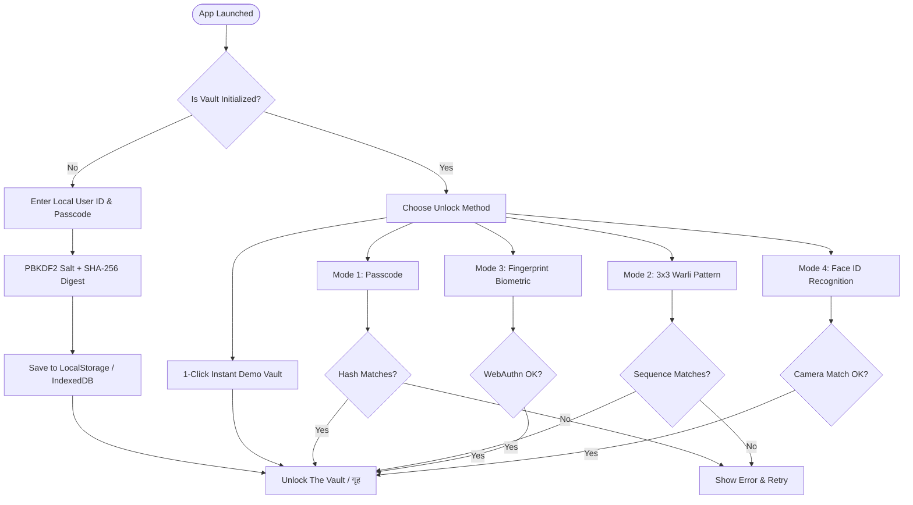
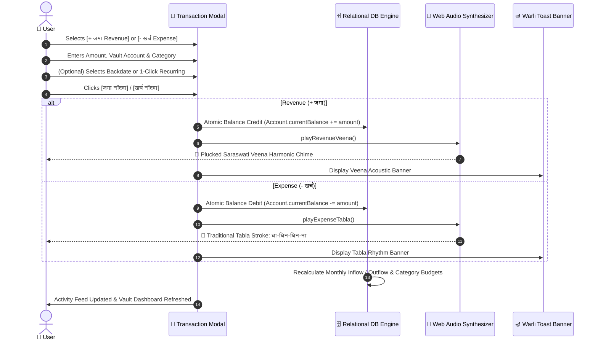
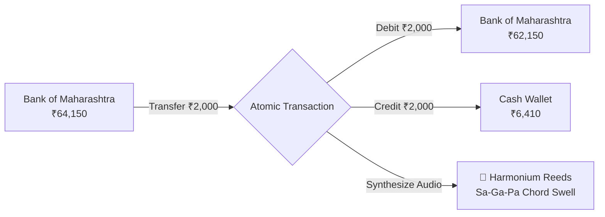

<div align="center">

# 🏺 अर्थसंयम (Arthasanyam)
### *100% Offline Maharashtrian Jamakharch Ledger & Warli Heritage Vault*

[](https://github.com)
[](https://github.com)
[](https://github.com)
[](./LICENSE)
[](./.github/workflows/build-release.yml)

<p align="center">
  <b>A privacy-sovereign personal accounting vault blending timeless Maharashtrian <i>Jamakharch</i> (जमाखर्च) principles, ancient Warli folk art aesthetics, and authentic synthesized Indian acoustic instruments.</b>
</p>

[Quick Start](#-quick-start--how-to-run-on-any-pc) •
[Core Privacy Mandate](#-core-privacy-mandate-zero-internet) •
[Architectural Modules](#-architectural-modules--feature-deep-dive) •
[Acoustic Instruments](#-acoustic-sound-simulation-cues) •
[Languages & Typography](#-languages--multilingual-engine) •
[Workflows & Visual Flowcharts](#-application-workflows--state-diagrams) •
[Building & Packaging](#-build-and-packaging-pipelines)

---

</div>

## 📖 Executive Summary & Philosophy

**अर्थसंयम (Arthasanyam)** re-imagines modern digital personal finance by rejecting the cloud-surveillance model. Traditional Indian households and traders maintained prosperity through deliberate reflection and physical ledger records (*Jamakharch*). 

Arthasanyam brings this mindful philosophy to modern devices:
- **Zero Cloud Reliance:** Your income, expenditures, savings goals, and habits never touch a remote server, third-party database, or analytics tracker.
- **Cultural Aesthetics:** Built using the sacred **Geru (गेरू / Terracotta Earth)** and **Tandul (तांदूळ / Rice Paste)** color system, framed by the sacred **Warli #16 (*Gavali* / Infinite Loop of Prosperity)** motif.
- **Acoustic Feedback:** Submitting financial entries plays pure, synthesized Indian classical and folk instruments—**सरस्वती वीणा (Veena)** for Revenue, **पारंपरिक तबला (Tabla)** for Expense, and **संवादिनी (Harmonium)** for Vault Transfers.

---

## 🔒 Core Privacy Mandate (Zero Internet)

```
                    ┌──────────────────────────────────────────────┐
                    │            ANDROID MANIFEST RULE             │
                    │   android.permission.INTERNET = REMOVED      │
                    │   ACCESS_NETWORK_STATE        = REMOVED      │
                    │   ACCESS_WIFI_STATE           = REMOVED      │
                    └──────────────────────┬───────────────────────┘
                                           │
            ┌──────────────────────────────┴──────────────────────────────┐
            ▼                                                             ▼
┌───────────────────────┐                                     ┌───────────────────────┐
│ LOCAL HARDWARE ONLY   │                                     │ CRYPTOGRAPHIC VAULT   │
│ • Local Web Crypto    │   ❌ ZERO TELEMETRY                 │ • PBKDF2 Salted Key   │
│ • SQLite / Relational │   ❌ ZERO CLOUD SYNC                │ • SHA-256 Digest      │
│ • Service Worker Cache│   ❌ ZERO THIRD-PARTY SDKs          │ • On-Device Biometrics│
└───────────────────────┘                                     └───────────────────────┘
```

1. **Manifest Hardening:** [`android/app/src/main/AndroidManifest.xml`](./android/app/src/main/AndroidManifest.xml) explicitly strips `android.permission.INTERNET`, `ACCESS_NETWORK_STATE`, and `ACCESS_WIFI_STATE` via `tools:node="remove"`.
2. **Cleartext & Backup Disabled:** `android:allowBackup="false"` and `android:usesCleartextTraffic="false"` prevent OS-level cloud leaks.
3. **Local Encryption:** User credentials and lock screen security keys are derived on-device with high-entropy 96-bit random salts and SHA-256 Web Crypto digests.

---

## 🚀 Quick Start — How to Run on Any PC

You have three frictionless ways to run Arthasanyam on your computer:

### 🌟 Option 1: Native Windows Desktop App (`Arthasanyam.exe` — Recommended)
- **Zero Setup Required:** No Node.js, Python, or runtime installation needed.
- Download [`Arthasanyam.exe`](./Arthasanyam.exe) from the repository root or GitHub Releases.
- Double-click `Arthasanyam.exe`. It launches an isolated, standalone desktop app window with its own dedicated local vault profile at `%LOCALAPPDATA%\Arthasanyam\VaultProfile`.

### 🌐 Option 2: Portable Single-File Offline App (`.html`)
- Download [`arthasanyam-portable-offline.html`](./arthasanyam-portable-offline.html).
- Double-click to open in any web browser (Google Chrome, Microsoft Edge, Brave, Mozilla Firefox).
- **Works 100% offline in Airplane Mode**; you can carry this single 320 KB file on a USB thumb drive or share it via Bluetooth/AirDrop.

### 💻 Option 3: Developer / Source Code Mode
```bash
# 1. Clone the repository
git clone https://github.com/YOUR_USERNAME/arthasanyam.git
cd arthasanyam

# 2. Install dependencies (Node.js 18+)
npm install

# 3. Launch live local development server
npm run dev
# or double-click Launch-Arthasanyam.bat on Windows
```
Open **http://localhost:5173/** in your browser.

---

## 🏗️ Architectural Modules & Feature Deep Dive

```
                                 ┌─────────────────────────┐
                                 │       अर्थसंयम APP      │
                                 └────────────┬────────────┘
         ┌───────────────────┬────────────────┼───────────────────┬───────────────────┐
         ▼                   ▼                ▼                   ▼                   ▼
   ┌───────────┐       ┌───────────┐    ┌───────────┐       ┌───────────┐       ┌───────────┐
   │ MODULE 1  │       │ MODULE 2  │    │ MODULE 3  │       │ MODULE 4  │       │ MODULE 5  │
   │  Security │       │ Dashboard │    │  Tijori   │       │ Category  │       │ Acoustic  │
   │  & Lock   │       │ The Vault │    │  Vaults   │       │  Mapping  │       │  Ledger   │
   └───────────┘       └───────────┘    └───────────┘       └───────────┘       └───────────┘
         │                   │                │                   │                   │
         ▼                   ▼                ▼                   ▼                   ▼
   ┌───────────┐       ┌───────────┐    ┌───────────┐       ┌───────────┐       ┌───────────┐
   │ MODULE 6  │       │ MODULE 7  │    │ MODULE 8  │       │ MODULE 9  │       │ MODULE 10 │
   │  Habits   │       │ Analytics │    │ Settings  │       │ Offline   │       │ Portable  │
   │  Triggers │       │ & Budgets │    │ & Languages       │ Database  │       │ Packager  │
   └───────────┘       └───────────┘    └───────────┘       └───────────┘       └───────────┘
```

### Module 1: Multi-Mode Lock Screen & Local Authentication
- **4 Unlock Authentication Modes:**
  1. **पासकोड (Passcode):** Alphanumeric password salted with a 96-bit on-device random salt.
  2. **पॅटर्न लॉक (Pattern Lock):** Interactive 3×3 Warli Chowk pattern grid.
  3. **फिंगरप्रिंट (Fingerprint):** Local biometric touch sensor integration via WebAuthn API.
  4. **फेस आयडी (Face ID):** Native on-device facial recognition authentication.
- **1-Click Demo Vault:** Allows instant evaluation without initial credentials.

### Module 2: Dashboard ("The Vault" / गृह)
- **Top App Bar:** Shows the app title (**अर्थसंयम**), active language environment switcher, dynamic streak counter (`🔥 ७ दिवस`), and the **Warli #16 (*Gavali*)** vector emblem.
- **Net Wealth Hero Card:** Aggregates real-time net balances across all local vaults, monthly revenue (`+ जमा`), and monthly expense (`- खर्च`).
- **Numeral Switcher:** Instant toggle between Devanagari numerals (`१, २, ३`) and standard international numerals (`1, 2, 3`).
- **Bank Accounts Carousel:** Horizontal scrollable vault cards with savings target progress indicators.
- **1-Click Recurring Templates:** Quick buttons to log frequent transactions (`अमृततुल्य चहा ₹20`, `दूध व वर्तमानपत्र ₹1,200`, `महावितरण वीज बिल ₹850`, `मासिक वेतन +₹28,500`) with zero typing.
- **Searchable Recent Activity Feed:** Instant filter by transaction type (`All`, `Revenue`, `Expense`), account vault, or keyword search across notes, amounts, and category translations.
- **Extended Bottom Dock:** Quick-access floating action buttons for `+ जमा (Revenue)` and `- खर्च (Expense)`.

### Module 3: Bank Accounts & Savings Vault Management (तिजोरी)
- Manage local vaults:
  - **बँक खाते (Bank Account)**
  - **बचत ध्येय / मुदत ठेव (Savings Goal / FD Vault)**
  - **रोख पाकीट (Daily Cash Batwa)**
- **Savings Goal Targets:** Set a customizable target goal (e.g., `₹1,50,000 Emergency Fund`) with interactive progress bars.
- **Vault-to-Vault Self-Transfer:** Transfer money between accounts (e.g., Bank → Cash Wallet) atomically without skewing monthly revenue/expense statistics.

### Module 4: Category Management & Unified Multi-Language Mapping
- **Unified Backend ID System (`cat_...`):** Every category maintains a permanent backend identifier. When you add custom categories, the context-aware modal prompts for equivalent terms in all other active languages.
- Changing the app language from Marathi to Hindi or English updates all UI labels while preserving 100% financial aggregation integrity.

### Module 5: Transaction Logging & Marathi Acoustic Simulation Cues
- Numeric input with instant quick-add currency chips (`+₹20`, `+₹50`, `+₹100`, `+₹500`, `+₹2,000`).
- **Category Dropdown + Top 4 Recently Used Category Chips:** Automatically surfaces your most frequently picked categories for fast one-tap logging.
- **Edit & Backdate Transactions:** Modify existing entries or select past dates via the calendar picker.

### Module 6: Smart Local Habit Triggers & Notifications
- **100% On-Device Background Worker:** Runs without external webhooks or cloud push servers.
- **Morning Intention Nudge (9:00 AM):** Positive daily prompt to promote mindful spending before heading out.
- **Evening Jamakharch Reflection (9:00 PM):** Daily prompt to reconcile cash and bank transactions.
- **On-Device Pattern Learning:** Analyzes local relational data on-device to highlight recurring spending patterns (e.g., afternoon tea or commute expenses).
- **Live Simulator:** Test sample push notification banners across Marathi, Hindi, and English.

### Module 7: Jamakharch Visual Analytics & Category Budget Limits
- **Warli Visual Donut Chart:** Interactive SVG chart comparing total inflow vs outflow.
- **Per-Category Budget Limits:** Set monthly spending limits per category with dynamic status badges:
  - 🟢 **Within Budget (< 80%)**
  - 🟡 **Warning Threshold (80% – 99%)**
  - 🔴 **Over Budget Alert (≥ 100%)**
- **Offline CSV Export:** Generates UTF-8 BOM CSV files formatted for Microsoft Excel and LibreOffice.
- **Print / PDF Statement:** Instant printable ledger view.

### Module 8: Settings, Languages & Local DB Inspector
- Change local passcode and user ID.
- Customize 3×3 pattern lock sequence and toggle biometrics.
- Add and manage regional Indian languages.
- View relational SQLite tables (`accounts`, `categories`, `transactions`, `budgets`).
- **Complete JSON Vault Backup & Restore:** Export full encrypted database to JSON or restore from an existing backup.

---

## 🎵 Acoustic Sound Simulation Cues

All acoustic cues are synthesized **directly inside the browser using the Web Audio API**. No external MP3/WAV audio files are required:

| Financial Action | Musical Instrument | Synthesis Architecture & Tonal Profile |
| :--- | :--- | :--- |
| **Revenue Logged (`+ जमा`)** | 🎻 **Saraswati Veena (सरस्वती वीणा)** | Plucked sawtooth & triangle oscillator bank with *Jawari* bridge harmonics, Meend fret glides (`Sa → Ga → Pa → Dha → Taar Sa`), and high sympathetic *Chikari* strings. |
| **Expense Logged (`- खर्च`)** | 🥁 **Traditional Tabla (तबला थाप)** | Authentic Indian percussion pair: left copper/clay *Bayan* bass with wrist pitch-bend modulation + right wooden *Dayan* playing the cadence **`धा - धिन - धिन - ना`**. |
| **Vault Transfer (`हस्तांतरण`)** | 🎹 **Marathi Harmonium (संवादिनी)** | Dual brass reeds (*Nar-Mada / Celeste*) with a +3.5 cent detune for a warm, hand-pumped bellows chord swell (`Sa-Ga-Pa → Tivra Ma → Taar Sa`). |

---

## 🌐 Languages & Multilingual Engine

Arthasanyam features an extensible localization engine supporting full Devanagari script rendering, Devanagari numerals, and regional dialects:

### Built-in Languages
- 🚩 **मराठी (Marathi)** — Default primary language
- 🇮🇳 **हिंदी (Hindi)** — Full localization
- 🇬🇧 **English** — Full localization

### 1-Click Regional Language Presets
- 🌊 **कोंकणी (Konkani)**
- 🕉️ **संस्कृतम् (Sanskrit)**
- 🌾 **ગુજરાતી (Gujarati)**
- 🏛️ **ಕನ್ನಡ (Kannada)**
- ☀️ **తెలుగు (Telugu)**
- 🪔 **தமிழ் (Tamil)**

Users can also define and add custom local languages (e.g., अहिराणी / Ahirani, मालवणी / Malvani) in the **Settings** menu.

### Typography & Fonts
- **Headings & Titles:** `Yatra One` / `Rozha One` (Devanagari serif display)
- **Body & Controls:** `Mukta` / `Hind` (Crisp Devanagari sans-serif)
- **Numerals & Monospace:** `Space Grotesk` / `Poppins`

---

## 🔄 Application Workflows & State Diagrams

### 1. Authentication & Vault Unlocking Workflow



---

### 2. Transaction Logging & Acoustic Cue Workflow



---

### 3. Vault-to-Vault Transfer Workflow



---

## 🛠️ Build and Packaging Pipelines

### Automated GitHub Actions Workflow (`.github/workflows/build-release.yml`)

Every git push to `main` or release trigger executes the automated CI/CD pipeline:
1. Sets up Ubuntu environment with Node.js 20.
2. Runs clean dependency install (`npm ci`).
3. Executes TypeScript verification (`tsc -b`).
4. Bundles Vite client assets into `dist/`.
5. Compiles single-file portable offline bundle (`scripts/bundle-singlefile.mjs`).
6. Builds the native standalone executable (`scripts/build-windows-exe.mjs`).
7. Uploads release-ready artifacts to GitHub Actions.

### Manual Local Build Commands

```bash
# 1. Full Production Build (Web Assets + Portable HTML)
npm run build

# 2. Build Native Windows Desktop Application (.exe)
npm run build:windows

# 3. Preview Production Build Locally
npm run preview
```

---

## 📁 Repository Directory Structure

```
arthasanyam/
├── .github/
│   └── workflows/
│       └── build-release.yml         # Automated GitHub Actions CI/CD pipeline
├── android/
│   └── app/src/main/
│       └── AndroidManifest.xml       # Hardened 100% offline Android manifest
├── public/
│   ├── manifest.json                 # PWA progressive web app manifest
│   ├── sw.js                         # Cache-First offline Service Worker
│   └── warli-icon.svg                # Warli #16 Gavali vector application icon
├── scripts/
│   ├── bundle-singlefile.mjs         # Inlines CSS/JS into standalone portable HTML
│   └── build-windows-exe.mjs         # Generates warli.ico and compiles Arthasanyam.exe
├── src/
│   ├── components/
│   │   ├── AccountsVaultModule.tsx   # Module 3: Tijori vaults & self-transfers
│   │   ├── AcousticToastBanner.tsx   # Visual Warli instrumental notifications
│   │   ├── AnalyticsBudgetModule.tsx # Module 7: Donut charts, budget limits & CSV
│   │   ├── CategoryMappingModule.tsx # Module 4: Unified Backend ID category mapper
│   │   ├── DashboardVault.tsx        # Module 2: The Vault hero dashboard & activity
│   │   ├── HabitTriggersModule.tsx   # Module 6: Morning/evening on-device nudges
│   │   ├── OfflinePrivacyInspector.tsx# Module 8: DB inspector, JSON export/import
│   │   ├── SettingsModule.tsx        # Settings: passcode, biometrics & languages
│   │   ├── SplashAuthScreen.tsx      # Module 1: Passcode, Pattern, Bio lock screen
│   │   ├── TransactionModal.tsx      # Module 5: Transaction entry, backdating & chips
│   │   └── WarliArt.tsx              # SVG Warli #16 Gavali, borders & illustrations
│   ├── i18n/
│   │   └── translations.ts           # Multilingual resource dictionary & presets
│   ├── types/
│   │   └── index.ts                  # TypeScript domain models and schemas
│   ├── utils/
│   │   ├── acousticEngine.ts         # Web Audio API Veena, Tabla & Harmonium
│   │   └── localDatabase.ts          # Local relational storage & crypto helpers
│   ├── App.tsx                       # Root container, router & state reconciler
│   ├── index.css                     # Tailwind CSS & Geru-Tandul typography
│   ├── main.tsx                      # Application bootstrap & SW registration
│   └── vite-env.d.ts                 # Vite environment definitions
├── windows/
│   ├── ArthasanyamApp.cs             # C# native Windows desktop host application
│   └── warli.ico                     # 32-bit Windows icon
├── Arthasanyam.exe                   # Standalone Windows Desktop executable
├── arthasanyam-portable-offline.html # Single-file portable offline bundle
├── Build-Android-APK.ps1             # PowerShell Android APK build automation
├── Launch-Arthasanyam.bat            # 1-Click Windows desktop launcher
├── capacitor.config.ts               # Capacitor offline mobile configuration
├── package.json                      # Project dependencies & build scripts
├── tailwind.config.js                # Geru (#9E3B24) & Tandul (#FBF8F5) theme
├── tsconfig.json                     # TypeScript compiler configuration
└── vite.config.ts                    # Vite bundler configuration
```

---

## 📜 License & Acknowledgements

- **License:** Released under the permissive [MIT License](./LICENSE).
- **Inspiration:** Dedicated to the indigenous Warli folk artisans of Maharashtra and the rich heritage of traditional Indian *Jamakharch* financial discipline.
- **Privacy:** 100% Offline-First. No tracking. No telemetry. All rights reserved by the device owner.
